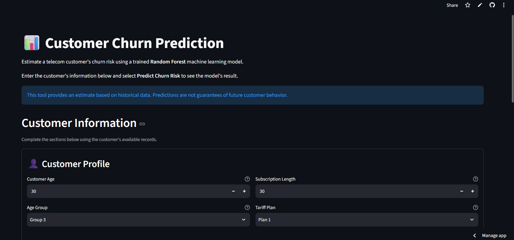
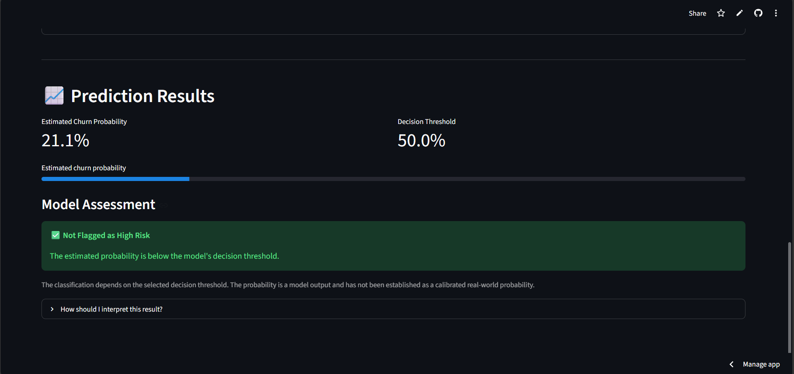

# Customer Churn Prediction

A machine learning project that predicts customer churn using telecom customer behavior and subscription data.

**🚀 Live Demo:** [Try the Web Application](https://customer-churn-prediction-2ueekxsoanbmgyxl5x7jbu.streamlit.app/)

**💻 Source Code:** [View the GitHub Repository](https://github.com/aidinpho/customer-churn-prediction)

## Key Features

- Compare multiple machine learning classification models.
- Predict customer churn using a trained Random Forest model.
- Estimate churn probability and classify customers based on a decision threshold.
- Validate customer inputs before making predictions.
- Explore model performance using precision, recall, F1-score, and accuracy.
- Run automated tests to verify prediction and input-validation behavior.


## Screenshots

### Customer Information Form



### Prediction Results



## Live Demo

Try the deployed application:

[**Open Customer Churn Prediction App**](https://customer-churn-prediction-2ueekxsoanbmgyxl5x7jbu.streamlit.app/)

## Project Overview

Customer churn occurs when a customer stops using a service. Predicting churn can help businesses identify customers who may need additional support or retention offers.

This project uses the Iranian Churn Dataset to train and evaluate machine learning classification models.

## Dataset

- **Source:** [Iranian Churn Dataset — UCI Machine Learning Repository](https://archive.ics.uci.edu/dataset/563/iranian+churn+dataset)
- **Rows:** 3,150
- **Candidate input features:** 13
- **Features used by the model:** 12 (`Status` is excluded)
- **Target:** `Churn` (`0` = no churn, `1` = churn)
- **Class distribution:** Approximately 84.29% non-churn and 15.71% churn

The dataset contains no missing values. Duplicate records and identical feature combinations with conflicting target labels were identified during data inspection and were not blindly removed.

## Models

The following classifiers were compared:

- Logistic Regression
- Decision Tree
- K-Nearest Neighbors (KNN)
- Random Forest

Data was split into training, validation, and test sets using stratified sampling, with an approximate 60% / 20% / 20% split.

Decision thresholds were evaluated using the validation set. The selected thresholds were then kept fixed for the final test evaluation.

## Test Results

| Model | Threshold | Precision (Churn) | Recall (Churn) | F1-score (Churn) | Accuracy |
|---|---:|---:|---:|---:|---:|
| KNN | 0.30 | 0.77 | 0.91 | 0.83 | 0.94 |
| Random Forest | 0.50 | 0.79 | 0.96 | 0.86 | 0.95 |

Random Forest is used by the prediction script. In the evaluated test split, it achieved a higher churn recall and F1-score than KNN.

These results come from a single stratified train/validation/test split. They do not guarantee the same performance on future customers.

## Project Structure

```text
customer-churn-prediction/
|-- app.py
|-- data/
|   `-- iranian_churn.csv
|-- models/
|   |-- churn_model.joblib
|   `-- threshold.txt
|-- src/
|   |-- inspect_data.py
|   |-- prepare_data.py
|   |-- compare_models.py
|   |-- feature_importance.py
|   |-- save_model.py
|   `-- predict_churn.py
|-- tests/
|   `-- test_predict_churn.py
|-- .gitignore
|-- README.md
`-- requirements.txt
```

## Installation

Clone the repository and navigate to the project directory:

```bash
git clone https://github.com/aidinpho/customer-churn-prediction.git
cd customer-churn-prediction
```

Create and activate a virtual environment.

**Windows PowerShell:**

```powershell
python -m venv .venv
.\.venv\Scripts\Activate.ps1
```

Install the dependencies:

```bash
python -m pip install -r requirements.txt
```

## Web Application

This project includes a Streamlit web application that allows users to enter customer information and estimate churn risk through an interactive interface.

The application displays:
- Estimated churn probability
- The model's decision threshold
- The predicted churn-risk classification

### Run the Web App

From the project root, activate your virtual environment and run:

```bash
python -m streamlit run app.py
```

Streamlit will start a local web server. Open the local URL displayed in the terminal to use the application.

The web app uses the saved Random Forest model and decision threshold from the `models/` directory.

## Run a Prediction

Run the prediction script:

```bash
python src/predict_churn.py
```

The script loads the saved model and decision threshold, validates the example customer input, and prints the predicted churn class and estimated probability.

The example customer in the script is synthetic and is intended only to demonstrate usage.

## Run Tests

Run the automated test suite:

```bash
python -m pytest -v
```

The test suite covers input validation, invalid values, categorical constraints, and prediction behavior using mocked model outputs.

## Feature Importance

The Random Forest model assigns high feature importance to features such as `Frequency of use`, `Seconds of Use`, `Complains`, and `Customer Value`.

Feature importance describes how the fitted model uses features; it does not establish that those features cause churn.

## Limitations

- Evaluation is based on a single train/validation/test split.
- The dataset contains duplicate records and some identical feature combinations with conflicting churn labels.
- The timing and availability of `Customer Value` in a real prediction setting have not been independently established.
- Predicted probabilities are model outputs and have not been established as calibrated real-world churn probabilities.
- This project is an educational machine learning demonstration and should not be used as the sole basis for business decisions.

## Technologies

- Python
- pandas
- NumPy
- scikit-learn
- joblib
- pytest
- Streamlit